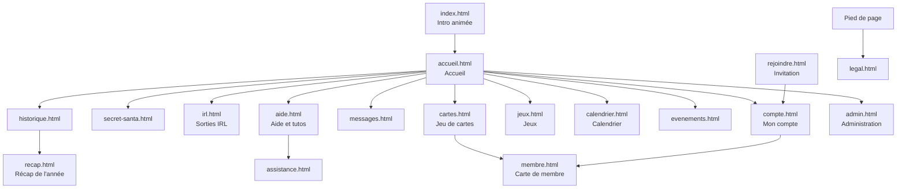

# Plan du site — Humane Gang

Toutes les pages, qui peut les voir, ce qu'elles contiennent, où est leur code et comment on y arrive.
Version : état du code au 28 octobre 2026, après le rangement du dépôt (pages dans `site/pages/`, code dans `site/assets/espaces/`).

Les adresses sont celles du site publié : `/pages/<catégorie>/<nom>.html`. Le plan du dépôt (où est quel fichier, où ranger un nouveau fichier) est dans [PLAN-DU-DEPOT.md](PLAN-DU-DEPOT.md).

## Vue d'ensemble

## Barre de menus

La barre comporte cinq entrées : « Le jeu de cartes », « IRL », « Jeux », « Calendrier » et « Autres ». « Le jeu de cartes », « IRL » et « Jeux » ouvrent un menu déroulant. « Calendrier » est un lien direct. « Autres » est rempli automatiquement. Un lien n'apparaît que si le membre a accès à sa page, et un menu vide disparaît. Sur téléphone (760 px et moins), un bouton « Menu » déplie les menus en accordéon.

| Menu | Entrées (adresse) |
| --- | --- |
| Le jeu de cartes | Ouverture (`/pages/cartes/cartes.html#ouverture`), Inventaire (`#inventaire`), Boutique (`#boutique`), Mes cartes (`#collection`), Classement (`#classement`), Échanges (`#echanges`), Arène (`#arene`) |
| IRL | Secret Santa (`/pages/irl/secret-santa.html`), IRL (`/pages/irl/irl.html`), Historique (`/pages/irl/historique.html`) |
| Jeux | Tous les jeux (`/pages/jeux/jeux.html#tous`), Jeux quotidiens (`#quotidien`), Jeux flash (`#flash`), Duels / multijoueurs (`#multi`), Jeux spéciaux (`#speciaux`). Chaque ancre de section ouvre la vue « Tous les jeux » et y fait défiler ; une section n'est proposée que si le membre y voit au moins un jeu. Entrées définies dans `header.js` (`JEUX_ITEMS`), titre du menu réglé comme l'ancien lien direct. Les jeux sont rangés en onglets dans cette page (voir plus bas). |
| Calendrier | Lien direct vers `/pages/irl/calendrier.html` |
| Autres | Pages du menu (réglage `in_nav` de la base) accessibles et non rangées ailleurs, dans l'ordre de la base. Libellés courts : Annuaire (`membre.html`), Récap de l'année (`recap.html`). |

Les libellés se règlent dans Administration › Site › Menu et pied de page ; les pages accessibles dans Administration › Membres › Accès aux pages.

Raccourcis clavier : « g » puis une lettre (aller à une page), « / » (recherche), « ? » (aide-mémoire des raccourcis), Ctrl ou Cmd + K (recherche).

## Menu en arc (photo de profil)

La photo de profil, à droite de la barre, ouvre un quart de cercle d'icônes. Rangée proche de la photo : Messages, Recherche, Mon compte. Rangée extérieure : Aide et tutos, Affichage (préférences d'affichage), Sans limite (mode sans limite, administrateur seulement), Admin ou Staff (si on y a droit), Changer de compte (admin et Staff, ou dès qu'un second compte est sur l'appareil : deux comptes au plus, passage de l'un à l'autre sans se déconnecter ; `core/comptes.js`), Déconnexion (de cet appareil seulement ; « Déconnecter tous mes appareils » est dans Mon compte).

Vue « comme un membre » (voir ADMIN-PANEL.md) : Admin, Staff et Sans limite sont masqués.

## Pages

Accès : **Public** = sans compte ; **Membre** = connecté ; **Staff** = membre avec au moins une permission ; **Admin** = administrateur. L'administrateur peut aussi masquer une page à certains membres (Membres › Accès aux pages) ou la donner par rôle (Membres › Rôles). « Selon Accès aux pages » : l'accès se règle dans le panel.

Les chemins de code sont relatifs à `site/assets/espaces/` (« espace » = un dossier, voir PLAN-DU-DEPOT.md). Un espace peut servir plusieurs pages.

### Pages d'accueil, compte et aide

| Page (adresse) | Accès | Contenu principal | Code (espaces/…) |
| --- | --- | --- | --- |
| `/index.html` | Public | Intro 3D au défilement, rejouée une fois par jour ; redirige ensuite vers l'accueil | `accueil/intro.js`, `intro-redirect.js`, `intro-logo.js` |
| `/pages/infos/rejoindre.html` | Public | Ouverture d'un lien d'invitation : donne un code et mène à l'inscription | `infos/rejoindre.js` |
| `/pages/compte/compte.html` | Public (connexion) puis Membre | Connexion, inscription, mot de passe oublié ; profil, avatar, infos personnelles, notifications Discord et push, badges, « Mes souvenirs » (cartes d'anniversaire communes reçues ou signées ; refus de la carte dans le profil), export et suppression des données | `compte/compte.js`, `accueil/carte-anniv.js` |
| `/pages/compte/accueil.html` | Membre | Fil d'activité (pastilles Tout · Le gang · Cartes · Badges et secrets, « Voir plus » par 10 jusqu'à 100), anniversaires des 30 prochains jours avec la carte commune à signer (J−3 à minuit le jour J ; jamais montrée à la personne fêtée avant le jour J, ni en « Voir le site comme… » ; bandeau le jour J dès 2 mots), défis du gang, question du jour, quêtes de la semaine, raccourcis Secret Santa / IRL / Historique | `accueil/accueil.js`, `accueil/anniversaires-liste.js`, `accueil/carte-anniv.js`, `accueil/intro-daily.js` |
| `/pages/compte/membre.html` | Membre | Carte de membre d'un joueur : infos partagées, badges, vitrine de cartes, « Voir sa collection » ; sur sa propre carte, bouton « Créer une image » (image PNG 1080 × 1350 de sa collection, téléchargée, aucun lien public) et bouton « Mes stats de jeux » vers `/pages/jeux/jeux.html#mes-stats` | `compte/membre.js` |
| `/pages/compte/messages.html` | Membre | Conversations privées, nouveau message, messages avec son Santa (anonymes), recherche dans mes messages (liste et loupe du fil), réactions émoji (sauf assistance) | `messages/messages.js`, `messages-groupes.js` |
| `/pages/compte/notifications.html` | Membre | Historique des notifications du site : filtres par catégorie, recherche, lecture et suppression, gardées 90 jours. Ouverte depuis « Voir tout l’historique » du panneau de la photo | `compte/notifications.js`, `commun/core/presence.js` |
| `/pages/compte/challenge.html` | Membre | Challenge de la semaine (menu Autres, migration 218) : consignes et compte à rebours, participation (fichier ou texte, légende, retrait), vote anonyme des participants (ordre mélangé, une voix), résultat (gagnant, ex æquo, « Choisi par l’admin »), challenges précédents. Carte sur l’accueil à côté du Défi du gang | `challenge/challenge.js`, `challenge/fichiers.js`, `challenge/challenge-commun.js`, `challenge/carte-accueil.js` |
| `/pages/infos/aide.html` | Public | Tutos illustrés en groupes, recherche, accès à l'assistance | `infos/aide.js`, `infos/tutos/` |
| `/pages/infos/assistance.html` | Public | Formulaire d'aide (bug, question, idée) et suivi de mes demandes | `infos/assistance.js` |
| `/pages/infos/legal.html` | Public | Mentions légales, confidentialité, cookies | `infos/legal.js` |

### IRL, événements et jeux du gang

| Page (adresse) | Accès | Contenu principal | Code (espaces/…) |
| --- | --- | --- | --- |
| `/pages/irl/secret-santa.html` | Membre | Édition en cours : inscription, avancement, ma cible et sa liste, ma liste de souhaits, mon envoi, messages secrets, inscrits | `irl/secret-santa.js`, `irl/ss-pairs.js`, `irl/ss-card.js`, `irl/ss-unwrap.js` |
| `/pages/irl/irl.html` | Membre | Prochaine sortie, dates à caler (sondages), à venir, sorties passées, statistiques, carte des lieux, toutes nos rencontres | `irl/irl.js`, `irl/irl-history.js`, `irl/irl-carte.js` |
| `/pages/irl/historique.html` | Membre | Frise des années, éditions passées du Secret Santa, albums photo, moments cultes et réactions | `irl/historique.js`, `irl/irl-history.js` |
| `/pages/irl/recap.html` | Membre | Récap de l'année du membre et du gang | `irl/recap.js` |
| `/pages/irl/calendrier.html` | Membre | Vue mois des rendez-vous : sorties IRL, séances du ciné-club, rendez-vous récurrents des groupes, anniversaires (jour et mois), dates du site ; filtres ; export d'un rendez-vous ; abonnement personnel (adresse ICS, régénérable). Sur téléphone (600 px et moins), le mois s'affiche en liste des jours qui ont quelque chose (jours passés repliés, aujourd'hui toujours affiché), avec un choix Liste / Grille retenu sur l'appareil | `irl/calendrier.js`, `irl/ics.js` |
| `/pages/irl/cine.html` | Membre | Ciné-club : vote de la séance (2 à 4 films), « Je serai là », lien du salon vocal | `irl/cine.js` |
| `/pages/irl/playlist.html` | Selon Accès aux pages | Playlist du gang : partage d'un morceau (YouTube, Spotify, Deezer, SoundCloud), vote pour le morceau de la semaine, réactions | `irl/playlist.js`, `irl/contenus.css` |
| `/pages/irl/citations.html` | Selon Accès aux pages | Mur des citations (contenu de la rubrique « Qui a dit ça ? ») | `irl/citations.js` |
| `/pages/irl/evenements.html` | Membre | Événements en cours et passés (images à attraper), classement des chasseurs ; les événements à venir ne sont pas montrés | `irl/evenements.js` |
| `/pages/jeux/secret.html` | Public (hors menu) | Le carnet des secrets : secrets trouvés et leur date, les autres comptés sans être nommés | `arcade/secret.js` |

### Jeu de cartes

| Page (adresse) | Accès | Contenu principal | Code (espaces/…) |
| --- | --- | --- | --- |
| `/pages/cartes/cartes.html` | Membre | Onglets Ouverture, Inventaire, Boutique, Mes cartes, Classement, Échanges, Arène (`#arene`) ; collection d'un autre membre en lecture seule (`#collection/<id>`), avec sa liste de souhaits et « Lui proposer » sur celles que j'ai en double ; dans Mes cartes, une série choisie à 1-5 cartes de la fin affiche « Il te manque N cartes » (qui les a en double, `hg_serie_manquantes`) ; Échanges › Enchères (`#echanges/encheres`, une enchère : `#echanges/encheres/<id>`) : cartes mises en vente par les membres (5 min à 24 h), « Mes enchères », mise en vente depuis la fiche d'une carte de Mes cartes (`cartes-encheres.js`, migration 212) | `cartes/cartes.js` et `cartes/cartes-*.js` |
| `/pages/cartes/collection-a4.html` | Membre | Planche A4 imprimable d'une collection (progression, grille de cartes possédées et manquantes), à imprimer ou enregistrer en PDF | `cartes/collection-a4.js` |

### Jeux (page Jeux et jeux indépendants)

| Page (adresse) | Accès | Contenu principal | Code (espaces/…) |
| --- | --- | --- | --- |
| `/pages/jeux/jeux.html` | Membre (selon Accès aux pages) | Onglet « Missions quotidiennes » (`#aujourdhui`, programme du jour et Paillettes gagnées), puis un onglet par jeu (liste des anchors plus bas). La vue « Tous les jeux » range les cartes en sections : Jeux quotidiens (une partie par jour), Jeux flash (à volonté), Jeux multijoueurs, Jeux spéciaux (ancres `#quotidien`, `#flash`, `#multi`, `#speciaux` : défilement jusqu'à la section), avec le classement du jour à côté. Au-dessus, filtre « Tous » seulement, la barre « Reprendre ma partie » réunit les parties ouvertes du membre (duels, Uno, Nom de code, Loup-Garou, plateaux) ; sans partie, elle n'existe pas. Juste au-dessus, le bloc « En direct » liste les parties publiques en cours qu'on peut regarder (Uno, Blackjack, Monopoly, Destins ; RPC `hg_jeux_en_direct`, migration 214) ; sans partie, il n'existe pas. Vue « Mes stats » (`#mes-stats`, ouverte depuis Ma carte, visible par le membre seul) : chiffres des 19 jeux du jour sur 7 jours, le mois ou depuis le début (parties, moyenne et meilleur score sur 10, Paillettes, série et record, rival = le membre juste au-dessus au classement de la période), liens vers les stats des duels, d'Uno et des plateaux ; RPC `hg_jeux_mes_stats` (migration 208) | `jeux/jeux.js`, `jeux/reprendre.js`, `jeux/en-direct.js`, `jeux/onglets.js`, `jeux/<id>.js`, `jeux/mes-stats.js` |
| `/pages/jeux/quiz.html` | Selon Accès aux pages | Questions du gang : réponses (une tentative par question), explication après réponse, Paillettes gagnées, historique | `quiz/quiz.js` |
| `/pages/jeux/duels.html` | Membre | Duels entre deux membres : bataille, dames, échecs, morpion, Puissance 4, Othello, Mastermind, pierre-feuille-ciseaux, Qui est-ce ? | `duels/duels.js`, `duels/vues/` |
| `/pages/jeux/uno.html` | Membre | Uno en ligne, 2 à 20 joueurs ; lien d'invitation `?code=` ou `#rejoindre/<code>` ; un joueur parti (Quitter, ou 3 tours manqués) garde sa place, un robot joue sa main en 3 s jusqu'à son retour (migration 211 ; sans retour, aucune Paillette). Mode spectateur (migration 214) : un membre regarde une partie publique dont la case « Spectateurs admis » est cochée (20 au plus), sans voir aucune main, avec son propre chat ; les joueurs le lisent dans l'onglet « Spectateurs » ; « Arrêter de regarder » ; bloc « En direct » à l'accueil | `uno/uno.js`, `uno/vues/`, `commun/spectateurs.js` |
| `/pages/jeux/loup-garou.html` | Membre | Loup-Garou multijoueur : salle, rôles, meneur, révélation, statistiques | `loup-garou/loup-garou.js`, `loup-garou/vues/` |
| `/pages/jeux/nom-de-code.html` | Membre | Codenames (Nom de code) en équipes : salle, plateau, fin de partie, statistiques (`#stats`) ; lien `?code=` ou `#rejoindre/<code>` | `nom-de-code/nom-de-code.js`, `nom-de-code/vues/` |
| `/pages/jeux/blackjack.html`, `catan.html`, `cluedo.html`, `destins.html`, `monopoly.html`, `pictionary.html`, `poker.html`, `risk.html`, `shadow-hunters.html` | Membre | Un jeu de plateau ou de cartes par page, partie en ligne entre membres (salle, table, fin de partie). Blackjack, Monopoly et Destins se regardent en spectateur comme le Uno (migration 214 ; rien de caché n'est envoyé au spectateur), bloc « En direct » à l'accueil du jeu | `plateaux/plateaux.js`, `plateaux/vues/spectateur.js`, `plateaux/<jeu>.css`, `plateaux/jeux/<jeu>/`, `plateaux/vues/` |
| `/pages/jeux/simulateur.html` | Hors navigation | Simulateur de téléphone, outil de test. Non publié selon docs/PUBLICATION.md. | `jeux/simulateur.js` |

### Pages système et affiches

| Page (adresse) | Accès | Contenu principal | Code (espaces/…) |
| --- | --- | --- | --- |
| `/pages/admin/admin.html` | Staff / Admin | Panel d'administration (détail dans ADMIN-PANEL.md) | `admin/admin.js`, `admin/admin-*.js`, `admin/admin-*.css` |
| `/404.html` | Public | Redirige les anciennes adresses vers les nouvelles ; sinon page introuvable, avec les mini-jeux de l'Arcade (Paillettes, Raclette, Domu-mobile) | `arcade/jeu404.js`, `arcade/eggs.css` |
| `/offline.html` | Public | Page affichée hors connexion | `commun/offline.css` |
| `/affiches/` (`site/affiches/`) | Public | Affiches A3 imprimables : badges, Paillettes, cartes, boosters, gamme | `affiches/affiches.js`, `affiches/gamme.js` |

Le code du panel est dans `site/assets/espaces/admin/` (coquille : `shell.js`, `router.js`).

## Adresses avec ancre (`#…`)

Une ancre choisit l'onglet ou la vue à l'ouverture. Elle ne charge pas une autre page.

**Cartes** (`/pages/cartes/cartes.html`) : `#ouverture`, `#inventaire`, `#boutique`, `#collection`, `#classement`, `#echanges`, `#arene`, `#collection/<id>` (collection d'un autre membre, lecture seule).

**Jeux** (`/pages/jeux/jeux.html`) : `#aujourdhui` (missions quotidiennes), `#mes-stats` (mes stats des jeux du jour, vue sans onglet), puis un onglet par jeu. Les onglets du tableau ci-dessous sont des jeux quotidiens (une partie par jour), sauf les jeux flash (jouables à volonté) : l’Arcade (`#arcade-…`), le Démineur et le 2048. Une seule partie par jour est récompensée pour l’Arcade, tous jeux confondus. Le détail des sections est dans `site/assets/espaces/jeux/catalogue.js` :

| Ancre | Jeu | Ancre | Jeu |
| --- | --- | --- | --- |
| `#geo` | GeoGuessr | `#carte-mystere` | Carte mystère |
| `#citations` | Qui a dit ça ? | `#jeu-video` | Jeu vidéo du jour |
| `#jour` | Question du jour | `#pochette` | Pochette du jour |
| `#sutom` | Sutom HG | `#replique` | Réplique du jour |
| `#framed` | Framed | `#pays` | Pays du jour |
| `#heardle` | Heardle | `#plat` | Plat du jour |
| `#arcade` | Arcade (`#arcade-paillettes`, `#arcade-raclette`, `#arcade-domu`) | `#connexions` | Connexions |
| | | `#mots-croises` | Mots croisés |
| | | `#mot-mele` | Mot mêlé |
| | | `#anagramme` | Anagramme |
| | | `#nerdle` | Nerdle du gang |
| | | `#demineur` | Démineur (compétition) |
| | | `#sudoku` | Sudoku du jour |

La liste des onglets vit dans `site/assets/espaces/jeux/onglets.js` : c'est elle qui fait foi si la page change.

**Séries des jeux du jour** : chaque jeu quotidien (et le Code du jour, page Duels `#jour`) montre la même pastille de série à droite de son en-tête (« 12 jours · à jouer avant minuit », « en danger » les 6 dernières heures, « 0 jour » en gris). Un jour compte si la partie est finie, gagnée ou perdue ; bascule à minuit (Zurich), à 6 h pour la Question du jour et GeoGuessr. Quand une série d'au moins 7 jours a cassé hier, l'encart « Sauver ma série » propose un joker payant (200 à 1 500 ✦ selon la série, un par semaine et par jeu, confirmation avant paiement) ; pour la Question du jour, il est dans « Ta semaine » et la case rachetée affiche « J✦ ». RPC `hg_jeux_series` (migration 206) et `hg_jeux_joker_payer` (migration 207) ; code commun `jeux/serie-jeux.js` et `jeux/jeux-serie.css`.

**Manches passées (pour l'honneur)** : sous Sutom, Framed, les 6 jeux « devine », les 5 grilles, le Sudoku et le Code du jour, les 30 dernières manches (liste « Grilles passées » / « Manches passées », grille d'images pour Framed, Pochette, Plat, Jeu vidéo et Carte mystère ; pour le Heardle, bouton « Jouer » dans l'historique). La réponse reste cachée tant que le membre n'a pas joué la manche. L'ancre de l'onglet suivie du jour ouvre une manche passée : `#sutom-2026-10-31`, `#pays-2026-10-31`, `#mots-croises-2026-10-31`…, `#jour/2026-10-31` sur la page Duels. Pour l'honneur : ni Paillettes, ni classement, ni série. RPC `hg_jeux_archive`, `hg_jeux_honneur_etat`, `hg_jeux_honneur_essai` (migration 213) ; code commun `jeux/archives-jeux.js` et `jeux/archives-jeux.css`.

**Accueil intro** : l'intro d'index.html est rejouée une fois par jour.

**Pronostics** : l'adresse de la page des pronostics de saison est réglable dans Administration › Saisons (par défaut `/pages/jeux/jeux.html#pronos`).

## Administration (`admin.html`)

Sept lieux, regroupés sur le plateau (`#plateau`), avec leurs sous-sections (détail, permissions et adresses : ADMIN-PANEL.md). Chaque sous-section demande une permission Staff, sauf mention « administrateur ».

| Lieu (adresse) | Sous-sections |
| --- | --- |
| La Place du gang (`#place`) | Membres (Comptes, Rôles, Champs du profil, Vie sociale, Accueil des membres) · Relances (À relancer, Invitations) · Entraide (Parrainage, Compétences) · Accès (Accès aux pages, Matrice membres × pages) · Badges (Catalogue, Attribution, Critères automatiques) |
| La Poste (`#poste`) | Demandes (Assistance, Modèles de réponse, Boîte à idées) · Échanges (Messagerie, Fil d'activité) · Discord (Bot Discord, Commandes slash) |
| La Salle des ventes (`#ventes`) | Enchères (enchère de la semaine, dont le lot se compose comme un give : Paillettes, cartes, séries, boosters, créé pour le gagnant à la fin ; une seule à la fois, migration 215 ; et en lecture les enchères des membres : qui a enchéri sur qui) · Échanges entre membres |
| Le Camp IRL (`#camp`) | Qui (Membres IRL) · Vivre les sorties (Sorties IRL, Souvenirs et photos) · Rendez-vous (Secret Santa) |
| La Fabrique de cartes (`#fabrique`) | Agir (Gestion globale, Drops, Codes cadeaux) · Arène · Catalogue (Séries, Cartes, Boosters) · Suivi (Joueurs, Statistiques) · Économie (Paillettes et dons, Tirage, Recyclage et fabrication, Limites) · Animations (Quêtes, Défis du gang, Challenges de la semaine, Cagnotte et bulletin, Cartes Champions, Atelier) |
| La Fête foraine (`#fete`) | Événements (Événements à thème, Calendrier et cinéma, Calendrier de l'Avent, Saison des Worlds, Anniversaire du gang) · Jeux (Questions du gang, Sutom du gang, GeoGuessr, Citations, Preuves de quêtes, Framed et Heardle, Arcade, Secrets, Mes jeux ; Loup-Garou, Uno, Codenames, Jeux de plateau et Duels réservés à l'administrateur) |
| La Mairie (`#mairie`) | Organisation (Planning, Journal, Staff) · Le site (Identité et mentions légales, Textes et intro, Menu et pied de page, Thème) · Technique (État du site, Erreurs du site, Entretien, Archives, Clés avancées) |

## Anciennes adresses

Avant le rangement, les pages étaient toutes à la racine du site (`/jeux.html`, `/accueil.html`…). Les nouvelles adresses sont sous `/pages/<catégorie>/`. Correspondance :

| Ancienne adresse | Nouvelle adresse |
| --- | --- |
| `/index.html` | `/index.html` (inchangée) |
| `/404.html` | `/404.html` (inchangée) |
| `/offline.html` | `/offline.html` (inchangée) |
| `/accueil.html` | `/pages/compte/accueil.html` |
| `/admin.html` | `/pages/admin/admin.html` |
| `/aide.html` | `/pages/infos/aide.html` |
| `/assistance.html` | `/pages/infos/assistance.html` |
| `/legal.html` | `/pages/infos/legal.html` |
| `/rejoindre.html` | `/pages/infos/rejoindre.html` |
| `/compte.html` | `/pages/compte/compte.html` |
| `/membre.html` | `/pages/compte/membre.html` |
| `/messages.html` | `/pages/compte/messages.html` |
| `/cartes.html` | `/pages/cartes/cartes.html` |
| `/collection-a4.html` | `/pages/cartes/collection-a4.html` |
| `/calendrier.html` | `/pages/irl/calendrier.html` |
| `/cine.html` | `/pages/irl/cine.html` |
| `/citations.html` | `/pages/irl/citations.html` |
| `/evenements.html` | `/pages/irl/evenements.html` |
| `/historique.html` | `/pages/irl/historique.html` |
| `/irl.html` | `/pages/irl/irl.html` |
| `/playlist.html` | `/pages/irl/playlist.html` |
| `/recap.html` | `/pages/irl/recap.html` |
| `/secret-santa.html` | `/pages/irl/secret-santa.html` |
| `/jeux.html` | `/pages/jeux/jeux.html` |
| `/quiz.html` | `/pages/jeux/quiz.html` |
| `/duels.html` | `/pages/jeux/duels.html` |
| `/uno.html` | `/pages/jeux/uno.html` |
| `/loup-garou.html` | `/pages/jeux/loup-garou.html` |
| `/nom-de-code.html` | `/pages/jeux/nom-de-code.html` |
| `/secret.html` | `/pages/jeux/secret.html` |
| `/simulateur.html` | `/pages/jeux/simulateur.html` |
| `/blackjack.html`, `/catan.html`, `/cluedo.html`, `/destins.html`, `/monopoly.html`, `/pictionary.html`, `/poker.html`, `/risk.html`, `/shadow-hunters.html` | `/pages/jeux/<même nom>.html` |

**Redirection automatique.** GitHub Pages sert `site/404.html` pour toute adresse inconnue. Son tout premier script lit le nom de page demandé : si c'est une page connue (`/jeux.html`, ou un lien parti dans la mauvaise catégorie comme `/pages/compte/duels.html`), il renvoie aussitôt vers la bonne adresse (`/pages/jeux/jeux.html`, `/pages/jeux/duels.html`) en gardant `?…` et `#…`. Les anciens liens (Discord, notifications, favoris, appli installée) continuent donc de marcher. Une page ajoutée au site doit aussi être ajoutée à sa table, en haut de `site/404.html`, et à `PAGE_DIR` dans `site/assets/commun/core/pages-access.js`.

## Ce qui tourne en arrière-plan

| Tâche | Quand | Rôle |
| --- | --- | --- |
| `hg-cron-5min` | Toutes les 5 minutes | Rappels de sorties et du Secret Santa, début et fin des événements, question du jour (9 h, réglable) |
| `hg-auctions-close` | Chaque minute (migration 212) | Clôture des enchères du jeu de cartes : enchère de la semaine et enchères des membres ; prévient la liste de souhaits 5 minutes avant la fin |
| `hg-badges-hourly` | Toutes les heures (à hh:07) | Attribution des badges |
| `hg-cards-hourly` | Toutes les heures (à hh:23) | Récompenses de présence du jeu de cartes |
| `hg-challenges-hourly` | Toutes les heures (à hh:17) | Progression et récompenses des défis du gang |
| `hg-wch-tick` | Toutes les 10 minutes | Challenges de la semaine : notification à l’ouverture du vote, clôture des votes échus, gagnants, Paillettes, notification du résultat |
| `hg-quests-hourly` | Toutes les heures (à hh:02) | Progression des quêtes |
| `hg-event-cards-hourly` | Toutes les heures (à hh:41) | Distribution des cartes d'événement |
| `hg-birthdays-daily` | 8 h, heure suisse | Messages et annonces d'anniversaire |
| `hg-cartes-anniv` | Toutes les heures (à hh:05), actif de 9 h à 22 h (Zurich) | Cartes d'anniversaire communes : ouverture à J−3 (notification du site « Anniversaires » à tous sauf la personne fêtée), rappel la veille aux non-signataires (migration 205) |

Fonctions edge (code dans `supabase/functions/<nom>/`) : `hg-notify` (notifications du site), `hg-support` (assistance), `hg-birthdays`, `hg-cron`, `hg-push` (notification push à chaque nouveau message ; « c’est ton tour » en push ou en MP, migration 200), `hg-album` (téléchargement d'un album en ZIP), `hg-archive` (archive annuelle en ZIP, administrateur), `hg-calendar` (flux ICS du calendrier), `hg-discord` (commandes slash du bot), `hg-nj-images` (images des jeux `nj-*`).
